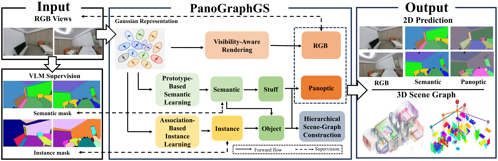
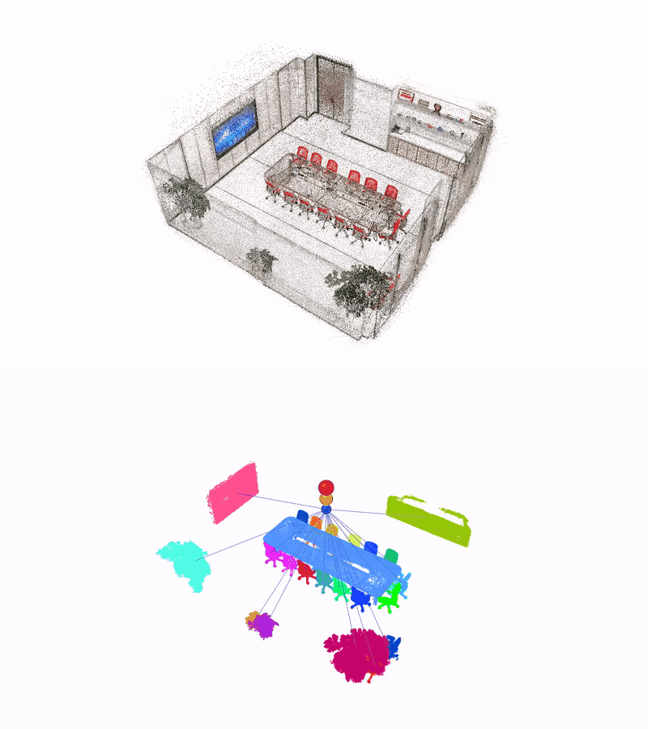
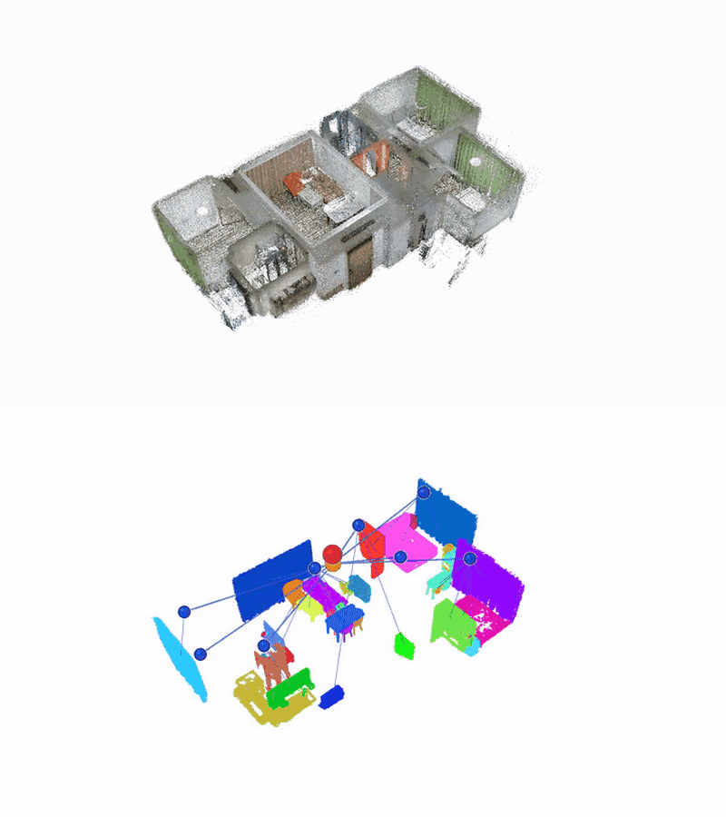
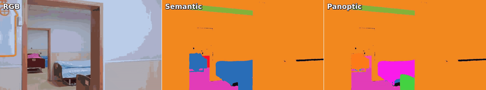
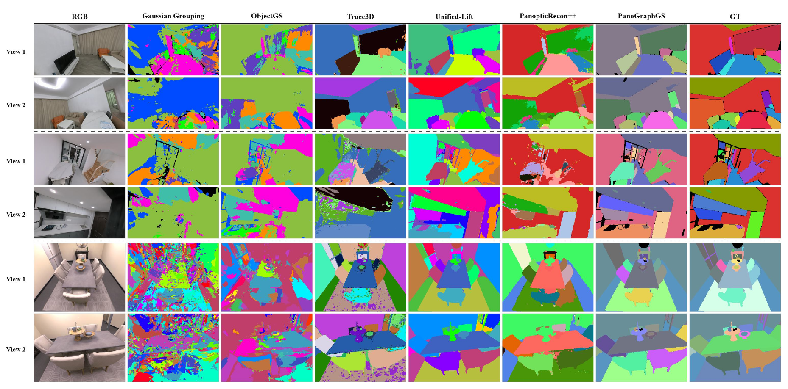

# PanoGraphGS: Unifying Panoptic Segmentation and Hierarchical 3D Scene Graphs with Gaussian Splatting

<p align="center">
  <a href="https://zj-humanoid.github.io/NaviGS/"></a>
  <a href="https://huggingface.co/datasets/zj-humanoid/NaviGS"></a>
  <a href="https://arxiv.org/abs/2610.27696"></a>
</p>

> Jinghan Gao, Siyu Wang, Dongyu Feng, Yiyuan Pan*, Rong Xiong



PanoGraphGS is a unified 3D Gaussian Splatting framework for **novel-view panoptic segmentation** and **hierarchical 3D scene graph construction**. Unlike pipelines that depend on incomplete or noisy per-frame RGB-D geometry, our method learns semantic and instance features directly on shared Gaussian geometry from multi-view RGB observations. The resulting representation provides globally consistent panoptic predictions and a **scene-floor-room-stuff-object** hierarchy with containment and spatial relations.

Across ScanNet++, Replica, and NaviGS, PanoGraphGS improves macro-average mIoU and mBIoU by **8.94%** and **10.60%** over the strongest evaluated baseline, and achieves **95.94% object-node accuracy** in hierarchical scene graph evaluation.

## NaviGS Dataset

[Open the NaviGS dataset page](https://zj-humanoid.github.io/NaviGS/)

We introduce **NaviGS**, a real-world dataset for panoramic scene understanding. It contains **120 high-fidelity scenes**, covers more than **50,000 m²**, and spans over **10 scene categories**.

The initial release includes five RGB scenes and five semantic scenes.

Each semantic scene includes:

- `RGB/` — RGB images
- `depth/` — Depth observations
- `lidar/` — LiDAR point clouds
- `pose/` — Camera poses and trajectories
- `3dgs/` — 3D Gaussian Splatting representations
- `mesh/` — Reconstructed meshes
- `scenegraph/` — Hierarchical 3D scene graphs

The scene graphs follow a **floor–room–stuff–object** hierarchy and encode semantic and spatial relationships between scene elements, supporting structured scene understanding and embodied navigation.

## Todo

- ✅ Release the NaviGS dataset.
- 🔜 Release the inference and evaluation code.

## Scene Graph

### Meeting Room



### Apartment



## 2D Semantic and Panoptic Segmentation

The shared Gaussian representation supports RGB, semantic, and panoptic rendering along smooth camera trajectories. The examples below demonstrate view-consistent predictions in real-world scenes.

### Resthome



## Experimental Results

### Hierarchical Scene Graph Identification

PanoGraphGS substantially improves floor, room, and object recognition over existing open-vocabulary scene graph pipelines.

| Method | Floor Acc. (%) | Room Acc. (%) | Object Acc. (%) |
|:--|--:|--:|--:|
| KeySG | 57.14 | 16.07 | 8.68 |
| HOV-SG | 50.00 | 48.16 | 16.62 |
| OP3DSG | - | - | 22.38 |
| BBQ | - | - | 28.20 |
| ConceptGraphs | - | - | 33.02 |
| **PanoGraphGS** | **100.00** | **100.00** | **95.94** |

### Novel-view Panoptic Segmentation

| Method | ScanNet++ mIoU | ScanNet++ mBIoU | Replica mIoU | Replica mBIoU | NaviGS mIoU | NaviGS mBIoU |
|:--|--:|--:|--:|--:|--:|--:|
| Gaussian Grouping | 15.67 | 13.03 | 23.94 | 16.98 | 56.91 | 35.86 |
| ObjectGS | 8.91 | 6.41 | 12.22 | 5.39 | 43.77 | 26.69 |
| Trace3D | 30.22 | 27.54 | 54.90 | 48.50 | 67.51 | 44.75 |
| Unified-Lift | 38.10 | 35.92 | 63.91 | 59.69 | 78.48 | 57.84 |
| PanopticRecon++ | 31.93 | 29.31 | 54.32 | 43.51 | 49.36 | 25.58 |
| **PanoGraphGS** | **41.06** | **37.89** | **76.73** | **70.51** | **83.19** | **64.39** |

#### Visualization



## Citation

If you find PanoGraphGS useful in your research, please consider citing our work:

```bibtex
@misc{gao2026panographgsunifyingpanopticsegmentation,
  title={PanoGraphGS: Unifying Panoptic Segmentation and Hierarchical 3D Scene Graphs with Gaussian Splatting},
  author={Jinghan Gao and Siyu Wang and Dongyu Feng and Yiyuan Pan and Rong Xiong},
  year={2026},
  eprint={2610.27696},
  archivePrefix={arXiv},
  primaryClass={cs.CV},
  url={https://arxiv.org/abs/2610.27696}
}
```
